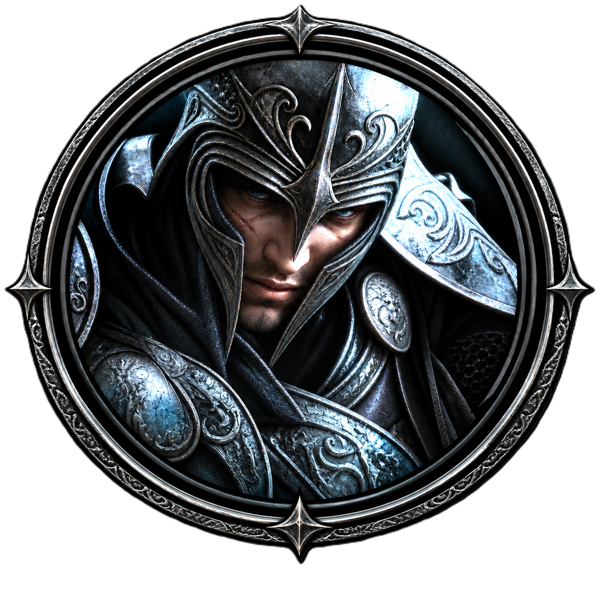

<p align="right">
  <a href="README.en.md"></a>
</p>

<p align="center">
  
</p>

<h1 align="center">ArchRust</h1>

<p align="center">
  <b>Client ArchLord réécrit en Rust</b><br>
  x86-64 · wgpu · AddOns Lua · patchs HD
</p>

**Réécriture en Rust (x86-64) du client ArchLord 64 bits**, avec un système d'AddOns Lua façon
World of Warcraft et un format de patch graphique HD pour les développeurs.

Les formats de fichiers et le protocole réseau ont été reconstruits par rétro-ingénierie de
l'exécutable du client (Ghidra piloté par [REA](https://github.com/morluto/rea)) et validés contre
les vrais fichiers du jeu et l'émulateur serveur [ArchCore](https://github.com/BlaMacfly/ArchCore).
Ce dépôt ne contient **aucune donnée du jeu** : il faut posséder son propre client.
Licence : [GPL-3.0-or-later](LICENSE.md).

## État

| Domaine | État |
|---|---|
| Chiffrement (RC4 CryptoAPI, Blowfish petit-boutiste, AES-128-GCM des index) | ✅ validé |
| Protocole AuPacket (en-tête 19 octets, schémas, trames, poignée de main) | ✅ validé avec ArchCore |
| Connexion → liste des mondes → compte → personnages → entrée dans le monde → PNJ en vue | ✅ `archrust login` |
| Ressources client (packs/disque, surcharge AES-GCM `etc`, qualité et ordre des textures, glTF natif) | ✅ règles reproduites et testées sur les données du client |
| Packs `Reference.Dat`/`Data.Dat` (character, object, textures, octree…) | ✅ tous les index lus |
| Modèles RenderWare (`.ecl`/`.dff` : frames, géométries, peaux, matériaux) | ✅ 200/200 testés |
| Textures `.tx1` (TXD RenderWare, DXT1/3/5, BGRA, palette) | ✅ 66/66 testées |
| Tuiles du monde (`MagPack` + aPLib) : secteurs, textures, attributs | ✅ 1280/1280 secteurs lus |
| Rendu wgpu (terrain autour du joueur, modèles, caméra orbitale), interface egui | ✅ terrain, joueur et PNJ affichés ([capture](docs/captures/anchorville.png)) |
| Textures du sol (base + couches fondues par masque, extension `0xfffff001`) | ✅ à l'échelle, transitions douces, validé en jeu |
| Objets du monde (`ini/obj%05d.ini` + `objecttemplate.ini`, pack `object`) | ✅ bâtiments, arbres, barrières, décor d'Anchorville ; LOD et animations à faire |
| Modèles de personnages (règle `charactertemplateclient.ini` → fichiers `a/b/c` en hexadécimal) | ✅ joueur et 18 PNJ d'Anchorville |
| AddOns Lua (`.toc`, frames, événements, slash, minuteurs, SavedVariables, LibStub + Ace3, API étendue) | ✅ voir [docs/ADDONS.md](docs/ADDONS.md) |
| Packs de ressources (`patch.toml`, dossier ou `.ahp` ; graphismes et sons ; priorités, repli, onglet « Packs de ressources » des Options, `saved-variables/packs.toml`) | ✅ textures, modèles, fichiers, sons ; voir [docs/PACKS-DE-RESSOURCES.md](docs/PACKS-DE-RESSOURCES.md) ; shaders pas encore appliqués |
| Déplacement (clic au sol, `/goto`), hauteur du terrain, paquet 0x40 et arrêt à l'arrivée | ✅ validé avec deux clients sur ArchCore ([capture](docs/captures/deplacement.png)) |
| Cycle d'entités `CHARACTER` (opérations update/remove/remove-for-view) | ✅ schéma et événements vérifiés sur le code Archonia/ArchCore |
| Action optimisée 0x41 | ✅ demande d'attaque, coups reçus (résultat, dégâts, PV restants), voir « Combat » |
| Inventaire et équipement (paquets 0x04 : porter, ranger, déplacer, réunir et séparer les piles, utiliser potions et parchemins, détruire, retour d'un aller-retour ; fenêtre du personnage `Character_Status` et ses emplacements, `C` ou `/perso` ; glisser-déposer, clic droit, Maj + clic ; `/utiliser`, `/porter`, `/ranger`, `/detruire`, `/retour`) | ✅ validé sur ArchCore (`examples/items.rs`, client graphique : [capture](docs/captures/personnage.png)) ; glisser-déposer pas encore essayé à la souris ; armes et boucliers pas encore rattachés aux os de la main, donc non affichés sur le joueur |
| Animations `.ean` (attente, course, attaque, coup reçu, mort) | ✅ validées en jeu sur ArchCore (TID 96 et Ver vert) |
| HUD d’Archonia (`UI_1024X768.ini`) : PV, PM, expérience, niveau, barre de raccourcis, menus, minicarte, améliorations | ✅ affiché en jeu sur ArchCore ([capture](docs/captures/hud.png)) ; contenu des raccourcis (UI_STATUS) à faire |
| Fenêtre d’inventaire d’Archonia (`UI_Inventory`) : 5 sacs, icônes `l%07x`, quantités, argent | ✅ affichée en jeu sur ArchCore ([capture](docs/captures/inventaire.png)) ; déplacer et détruire faits (voir « Inventaire et équipement »), vente aux PNJ faite (voir « PNJ ») |
| Sélection et création de personnage (scène d'origine `LoginSettings.txt` : salle du trône, temples par race, caméras, zoom) | ✅ liste, création race/classe/visage/coiffure/nom, suppression, entrée en jeu, validés sur ArchCore |
| Orientation et têtes par défaut | ✅ personnages tournés vers leur marche, visage et cheveux skinnés (`character\defaulthead`), validés en jeu (TID 96) |
| Son (musique de région `RegionTemplate.ini` → `skyset.ini`, ambiance, effets des packs `.pk` et de `sound/ui`, volumes, `PlaySound` des AddOns) | ✅ rodio ; musique, ambiance (jeux d'effets `efffile_set.eff`) et heure du jeu validées à Anchorville sur ArchCore, effets des packs aussi |
| Groupes (paquets 0x08 / 0x09 : invitation, acceptation, refus, départ, exclusion, passage de chef, réglages ; fenêtre du groupe avec PV, `/inviter`…, API de groupe des AddOns) | ✅ validés sur ArchCore avec deux joueurs (client graphique + `examples/party.rs`) |
| Guildes (paquets 0x15 / 0x39 : gestionnaire de guilde (bouton « Guilde » du dialogue, `/registraire`), création, invitation et boîte OK / Annuler d'Archonia, adhésion, demande de départ et accord du chef, exclusion, dissolution avec mot de passe, annonce ; fenêtres d'origine `Guild_Main`, `Guild_Create`, `Guild_Destroy`, leurs confirmations, `Guild_Notice` et `Guild_Member` (`G`) ; messages de `uimessage.txt`) et discussion de guilde et de groupe (`/G texte`, `/P texte`, lignes « [Guilde][Nom] » et « [Groupe][Nom] » aux couleurs de `color.ini`, onglets Universel, Groupe, Guilde, Chuchotement) | ✅ validées sur ArchCore avec deux joueurs (`examples/guild.rs`, client graphique) ; emblèmes, agrandissement, changement de nom, second, combats et alliances non gérés par ArchCore (boutons inactifs) ; nom de guilde au-dessus des têtes à faire |
| Combat (attaque par clic droit, clic sur la cible, `F` ou `/attaquer` ; barre de PV de la cible, chiffres de dégâts et message par coup ; animations d'attaque, de coup reçu et de mort ; mort et fenêtre `UI_Resurrection` « Ressusciter au village » ; objets au sol avec leur modèle, ramassage par clic, `Espace` ou `/ramasser`, or crédité ; expérience et niveau au HUD ; événements des AddOns `PLAYER_DEAD`, `PLAYER_ALIVE`, `PLAYER_LEVEL_UP`, `CHAT_MSG_LOOT`…) | ✅ validé sur ArchCore contre un Ver vert : victoire, butin ramassé, mort et résurrection au village (client graphique + `examples/combat.rs` ; captures [butin](docs/captures/combat-butin.png), [mort](docs/captures/combat-mort.png)) |
| PNJ (fonctions du champ 4 de leur vue ; dialogue `UI_NPCDialog` avec `npcdialog.txt` ; boutique `UI_NPCTrade` : achat, quantité, vente après accord ; banque `UI_Bank` : 4 pages, objets et argent ; quêtes `QuestAccept_UI` et journal `QuestMain_UI` (`L`) d'après `questgroup.ini` et `questtemplate.ini` : prise, fin, abandon, progression ; clic sur un PNJ ou `/parler`, `/boutique`, `/banque`, `/quetespnj`, `/quetes`) | ✅ validé sur ArchCore (`examples/npc.rs`, client graphique : captures [boutique](docs/captures/boutique.png), [quêtes](docs/captures/quetes.png)) ; boutons et glisser-déposer pas encore essayés à la souris ; le client français ne décrit qu'une soixantaine de quêtes (les autres s'affichent par leur numéro) |
| Portails (paquet 0x31 : clic sur l'objet du décor qui porte le portail, `obj*.ini` fonction 8 ; liste `UI_Teleport` d'après `TeleportPoint.ini`, `TeleportFee.txt` et `RegionGlossary.txt`, statuts or insuffisant / indisponible ; écran `UI_LG_Loading` pendant le trajet ; `/portail`, `/portail nom`) | ✅ validé sur ArchCore : Anchorville → Repaire de l'éclaireur pour 100 pièces (`examples/portal.rs`, client graphique avec clics à la souris sur le portail et la ligne : capture [portail](docs/captures/portail.png)) ; confirmation des zones dangereuses et « Retour » à faire |
| Banque agrandie (bouton « Agrandir » d'`UI_Bank`, fenêtre `UI_BuyBank` avec le prix de `bankslotprice.txt`, or vérifié avant l'envoi, AGPMITEM op 22 ; onglets ouverts selon le champ 23 ; messages 29 / 30 ; `/agrandir`) | ✅ validé sur ArchCore (`examples/portal.rs`, client graphique : capture [agrandir](docs/captures/banque-agrandir.png)) ; bouton pas encore cliqué à la souris |
| Compétences (liste à l'entrée en jeu, points ; livre `UI_Skill` (`K`, `/competences`) ; instructeur `UI_SkillBuy` d'après la classe enseignée et `SKILL_CONST.txt` : apprendre, améliorer ; lancement sur la cible ou sur soi, délai de relance affiché ; barre de raccourcis de `UI_CharInfo` (touches 1 à =, potions sur 1 et 2) remplie par glisser-déposer, enregistrée par personnage ; `/lancer`, `/instructeur`) | ✅ validé sur ArchCore (`examples/skills.rs`, client graphique : captures [instructeur](docs/captures/instructeur.png), [livre et barre](docs/captures/competences.png)) ; glisser-déposer et clics pas encore essayés à la souris ; compétences héroïques et onglets du livre à faire |

## Démarrage rapide

Prérequis : Rust stable (MSVC), un client ArchLord 64 bits dans `../client/ArchLord/Game`, et pour
jouer, ArchCore lancé (MariaDB + `npm start`).

```bash
cargo build --release
cargo run --release -- inspect pack character              # liste un pack
cargo run --release -- inspect model character a0000005.ecl
cargo run --release -- inspect animation a0060000.ean --time 0.5 --model b0000060.ecl
cargo run --release -- extract texture a0057aab a0057aab.png   # texture décodée
cargo run --release -- inspect sound index                 # soundpak.info : packs de sons
cargo run --release -- inspect sound sd.pk --limit 5       # un pack .pk (ou effect/mono/maa.pk)
cargo run --release -- extract sound sd0000.wav sd0000.wav # un son d'un pack (ou sound/ui/block.wav)
cargo run --release -- login test test Testeur             # flux complet sans affichage
cargo run --release -- play --connect test:test@127.0.0.1:11002/Testeur
cargo run --release -- addons                              # vérifie les AddOns
cargo run --release -- patch build patches/mon-patch mon-patch.ahp
```

### Installation à côté du client et `realmlist.wtf`

`ArchRust.exe` (icône : le logo officiel d'ArchRust, `apps/archrust/res/archrust.ico`) peut être posé dans le dossier `Game` du client, à la place d'`Archonia.exe`, avec
`addons/`, `free-assets/` et `patches/` : il y reconnaît le client sans option, et un double-clic
lance le jeu (`play` est la commande par défaut).

Le serveur de connexion se règle comme dans World of Warcraft, par un fichier `realmlist.wtf` :

```text
# commentaire
set realmlist 127.0.0.1:11002
```

Forme `set realmlist <hôte>[:<port>]` (port 11002 par défaut, guillemets facultatifs, la dernière
ligne l'emporte). Le fichier est cherché à côté de l'exécutable, puis dans le dossier courant, puis
dans le dossier `Game` ; il préremplit l'écran de connexion. `--connect utilisateur:mdp@/personnage`
(sans hôte) se connecte à ce serveur ; un hôte donné à `--connect` reste prioritaire.

L'écran de connexion affiche `crates/archrust-engine/assets/login-screen.png` (« ArchRust — Awakening of the
Eternal Storm ») et, par-dessus, le panneau illustré `crates/archrust-engine/assets/login-panel.png` : les champs,
la case « Enregistrer le compte » et les boutons sont posés sur leur dessin. Les deux images sont intégrées à
l'exécutable ; comme dans WoW, l'interface des AddOns n'apparaît qu'en jeu.

Après la connexion, l'écran de sélection reprend la scène d'Archonia (personnages du compte dans
la salle du trône, clic pour choisir) ; « Créer un personnage » ouvre la scène de création de la
race choisie. Pour les tests : `--connect test:test@` (sans `/personnage`) passe par ces écrans et
`--login-exec "créer; race Orc; classe Berserker; visage 3; nom Grokk; valider; choisir 1; entrer"`
y joue des commandes.

Dans le jeu : clic gauche au sol pour marcher, clic droit pour orbiter, molette pour zoomer,
ZQSD/WASD pour déplacer la caméra, `` ` `` ouvre la console Lua, la fenêtre de discussion accepte
les commandes `/` (`/goto x y z`, `/cam distance [lacet°] [tangage°]`, `/reload`, `/quit`, et celles des AddOns). Pour les tests :
`--exec "/goto …"` exécute une commande à l'entrée en jeu et `--screenshot fichier.png` enregistre
une capture puis quitte (sous Git Bash, préfixer par `MSYS_NO_PATHCONV=1`).

## Architecture

```text
crates/
  archrust-crypto     RC4 (MD5 CryptoAPI), Blowfish LE, AES-128-GCM
  archrust-protocol   AuPacket, schémas de champs, trames A1/B1, poignée de main
  archrust-data       tables ini, packs, MagPack + aPLib, RenderWare (DFF/TXD/secteurs), packs de sons .pk
  archrust-netclient  client tokio : login, monde, événements, commandes
  archrust-addons     Lua 5.4 (mlua), .toc, frames, événements, slash, SavedVariables, LibStub/Ace3
  archrust-patch      manifeste TOML, pile de patchs, archives .ahp
  archrust-engine     winit + wgpu + egui : rendu, terrain, entités, interface, liaison réseau, audio (rodio)
apps/archrust         exécutable : play / login / inspect / extract / addons / patch
addons/HelloArch      AddOn d'exemple (API de base)
addons/ArchAce        AddOn d'exemple LibStub/Ace3 (cadres d'unité, plaques de nom, thème, options)
docs/FORMATS.md       formats de fichiers reconstruits
docs/ROADMAP-ARCHONIA.md jalons de reconstitution du comportement d'Archonia
docs/REFERENCE-BENILLA.md logiques reprises de benilla (client WoW 1.12.1 en Rust, MIT/Apache), après Archonia
```

## AddOns

Un AddOn vit dans `addons/<Nom>/` avec un fichier `<Nom>.toc` :

```text
## Title: Hello ArchLord
## Interface: 10000
## SavedVariables: HelloArchDB
core.lua
```

L'API reprend celle de WoW pour que le code et les habitudes se transposent : frames en tables Lua
(`CreateFrame`, ancres, strates, textures, polices `.ttf`, `GameTooltip`, `StaticPopup`, panneau
d'options), événements (`PLAYER_LOGIN`, `UNIT_HEALTH`, `PLAYER_TARGET_CHANGED`, `CHAT_MSG_*`,
`COMBAT_LOG_EVENT_UNFILTERED`…), `Unit*`, `C_Timer`, `SlashCmdList`, `hooksecurefunc`, CVars. Les
bibliothèques Lua standard sûres sont ouvertes (`string`, `table`, `math`, `utf8`, `coroutine`, `os`
réduit, `bit`/`bit32`, `require` borné aux dossiers d'AddOns) avec les alias de WoW (`strsplit`,
`tinsert`, `wipe`, `format`…), et LibStub, CallbackHandler, Ace3 (AceAddon, AceEvent, AceTimer,
AceConsole, AceDB, AceHook, AceLocale, AceSerializer), LibDataBroker et LibSharedMedia sont
intégrées. L'espace `ArchRust` permet de modifier le client : caméra, couleur du ciel et lumière,
teinte des modèles, couleurs des fenêtres natives, raccourcis clavier, plaques de nom
(`ArchRust.WorldToScreen`). Les AddOns se chargent à l'entrée en jeu, comme sous WoW. Pas d'accès
disque hors des fichiers des AddOns et de leurs SavedVariables.

Avec un serveur ArchCore qui gère les extensions ArchRust (paquet `0xAC`, négocié à chaque connexion), les
AddOns s'échangent des messages entre joueurs : `C_ChatInfo.SendAddonMessage`, `CHAT_MSG_ADDON`,
AceComm-3.0 (messages longs découpés) et ChatThrottleLib, avec un débit lissé selon les limites du
serveur. Sans extensions, le client fonctionne comme avant.

Référence complète : **[docs/ADDONS.md](docs/ADDONS.md)**. Exemple : `addons/ArchAce` (`/archace`).

## Packs de ressources (patchs HD)

Guide complet pour créer, installer et partager un pack : [docs/PACKS-DE-RESSOURCES.md](docs/PACKS-DE-RESSOURCES.md).

Un patch est un dossier (ou une archive `.ahp`) avec un `patch.toml` :

```toml
[patch]
id = "anchorville-hd"
name = "Anchorville HD"
version = "1.0.0"
priority = 100

[[textures]]
match = "a0057aab"            # nom RenderWare, motif * accepté
file = "textures/a0057aab.png" # PNG, DDS, BMP, JPEG, TGA, TIFF ; toute taille

[[models]]
match = "character/a0000001.ecl"
file = "models/a0000001.glb"
scale = 100.0                 # glTF en mètres → unités ArchLord (≈ cm)

[[files]]
path = "ini/npc.ini"
file = "npc.ini"

[[sounds]]
path = "ui/block.wav"
file = "sons/bip.wav"
```

Les packs de la communauté (`patches/`) passent avant le pack officiel (`free-assets/`), chacun par
priorité décroissante ; le premier qui fournit une ressource l'emporte, sinon les données d'origine sont
utilisées. Un fichier absent ou illisible passe la main au pack suivant. Dans le jeu, Options (Échap ou
`/reglages`) → « Packs de ressources » active, désactive et ordonne les packs (au prochain démarrage). Les `[[models]]` glTF/GLB sont
affichés à la place du modèle du client (personnages, PNJ, secteurs `world/D272,272.dff`), avec leurs
propres textures ; `archrust inspect gltf <fichier>` décrit un glTF.

## Son

Le moteur audio (`rodio`, décodage MP3/WAV par Symphonia) joue trois pistes :

* **musique** : MP3 en boucle avec fondu enchaîné. Sur les écrans de connexion, `sound/bgm/htt_001.mp3`
  (CVar `loginMusic`) ; en jeu, la musique de la région du joueur d'après les tables du client
  (grille `.amf` du secteur → `RegionTemplate.ini` → `skyset.ini`, par tranche horaire, voir
  [docs/FORMATS.md](docs/FORMATS.md)), sinon `worldMusic` ;
* **ambiance** : `sound/stream/*.mp3` en boucle, d'après les jeux d'effets de la région
  (`skyset.ini` `HH_EffectIndex_NN` → `effect/ini/new/efffile_set.eff`, par exemple `a_grn_d.mp3`
  dans la plaine d'Anchorville de jour), sinon la CVar `worldAmbience`. L'heure des tranches est
  celle du jeu, reçue du serveur (paquet `AGPMTIMER`, heure UTC avec ArchCore), locale sans
  serveur ; `/music` l'affiche ;
* **effets** : WAV ponctuels, `sound/ui/<nom>.wav` (pack), `sound/effect/sd0000.wav` (entrée d'un
  `.pk` par `soundpak.info`, ou balayage RIFF pour `effect/mono/`), fichier d'un AddOn.

Tous les sons passent par les patchs : un `[[files]]` sur `sound/bgm/htt_001.mp3` ou
`sound/effect/sd.pk` remplace la musique ou tout un pack. Sans client (`--no-client`), seuls les
sons fournis par les patchs sont joués, en silence sinon.

Volumes (musique, ambiance, effets, coupure) : fenêtre **Options** (bouton ou touche Échap),
enregistrés dans `saved-variables/options.toml`. Commandes : `/music <chemin>|off|auto`,
`/sound <chemin>` ; AddOns : `PlaySound`/`PlaySoundFile(chemin)`, `PlayMusic(chemin)`, `StopMusic()`.

## Données du client et ressources libres

Le dépôt sépare strictement ce qui appartient à l'éditeur de ce qui peut être publié :

| Dossier | Contenu | Publié ? |
|---|---|---|
| `assets-archonia/` | le dossier `Game` du client (ou un lien vers lui) ; cherché en premier par ArchRust | **Non** : ignoré par git, sauf son README |
| `free-assets/` | tes créations originales (textures, modèles glTF, fichiers), déclarées dans `patch.toml` ; patch de priorité maximale | Oui |
| `patches/` | patchs HD tiers (`.ahp` ou dossiers) | au choix |

Une texture ou un modèle du jeu retouché reste une œuvre dérivée : il ne va pas dans `free-assets/`.
Au fur et à mesure que les ressources libres remplacent celles du client, le jeu devient jouable
sans aucun fichier d'origine :

```bash
cargo run --release -- play --no-client            # patchs et substituts seulement
```

Sans client, tout ce qui manque est remplacé par un substitut généré (damier coloré, boîte, table
vide) et la fenêtre de connexion fonctionne normalement. Les sources de packs libres (CC0) et la
correspondance nom du client → fichier libre sont dans [docs/ASSETS-LIBRES.md](docs/ASSETS-LIBRES.md).
Tout ce que le dépôt ne fournit pas (client, exports de référence, interface HD, sons, patchs `.ahp`) :
où le trouver, où le poser et comment le vérifier, dans [docs/ASSETS-NON-FOURNIS.md](docs/ASSETS-NON-FOURNIS.md).

## Avertissement

ArchLord est une marque de son éditeur. ArchRust est un projet indépendant, non affilié, à but
d'étude, d'interopérabilité et de préservation. Voir [LICENSE.md](LICENSE.md).

<p align="right">
  <a href="README.en.md"></a>
</p>
