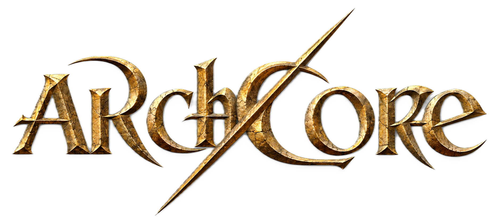

<p align="center">
  
</p>

<h1 align="center">ArchCore</h1>

<p align="center">
  <b>Émulateur serveur ArchLord — ArchLord server emulator</b><br>
  Node.js · MariaDB · rétro-ingénierie du client / client reverse engineering
</p>

<p align="center">
  <a href="#-français">🇫🇷 Français</a> ·
  <a href="#-english">🇬🇧 English</a> ·
  <a href="https://github.com/BlaMacfly/ArchCore/wiki">📖 Wiki</a> ·
  <a href="https://discord.gg/T3jfR6ftak">💬 Discord</a>
</p>

<p align="center">
  <a href="https://discord.gg/T3jfR6ftak"></a>
</p>

---

## 🇫🇷 Français

**ArchCore** est un émulateur de serveur (login + monde) pour le client **ArchLord 64 bits**. Il est écrit en Node.js et stocke ses données dans **MariaDB**. Le protocole a été
reconstruit par rétro-ingénierie de l'exécutable du client avec Ghidra, via [REA](https://github.com/morluto/rea),
et à partir des tables de données du client.

> ArchCore est basé sur le client 64 bits du serveur Archonia.

### État du projet

| Fonction | État |
|---|---|
| Poignée de main chiffrée (Blowfish) | ✅ validée avec le vrai client |
| Liste des mondes, connexion au compte | ✅ validée |
| Liste, création et suppression de personnages | ✅ liste et écran de création validés |
| Entrée dans le monde, village de départ par race | ✅ validée |
| Apparition des PNJ autour du joueur (567 PNJ) | ✅ validée |
| Traduction française du client et des PNJ | 🟡 en cours |
| Déplacement, joueurs visibles entre eux | 🟡 validés au simulateur, à confirmer en jeu |
| Dialogues, boutiques, monstres, combat | ⏳ à faire |
| Discussion, niveau MJ, premières commandes MJ | 🟡 validés au simulateur, à confirmer en jeu |
| Objets, compétences, groupes, reconnexion | ⏳ à faire |

### Démarrage rapide

Prérequis : Node.js 20 ou plus, MariaDB, et un client ArchLord 64 bits extrait dans `../client/ArchLord/Game`.

```bash
npm install
db\start-mariadb.cmd                          # instance MariaDB locale (Windows)
node tools/db-init.mjs --account test test    # schéma + compte de test
node tools/decrypt-client-data.mjs            # déchiffre les tables du client
node tools/import-client-data.mjs             # importe les tables dans MariaDB
npm start                                     # login sur 11002, monde sur 11008
npm run sim -- test test Testeur              # rejoue un client complet, sans le jeu
```

Pour connecter le jeu, voir la page [Installation](https://github.com/BlaMacfly/ArchCore/wiki/FR-Installation) du wiki.

### Documentation

Le [wiki](https://github.com/BlaMacfly/ArchCore/wiki) détaille l'installation, la configuration,
l'architecture du code, le protocole réseau, la base de données, les outils et la traduction.
Les mêmes pages sont dans [`docs/wiki`](docs/wiki).

### Communauté

Rejoignez le Discord officiel pour suivre le projet, poser vos questions et proposer votre aide :
https://discord.gg/T3jfR6ftak

### Avertissement

ArchLord est une marque de son éditeur. ArchCore est un projet indépendant, non affilié, à but
d'étude et de préservation. Ce dépôt ne contient **aucune donnée du jeu** : il faut posséder son
propre client.

---

## 🇬🇧 English

**ArchCore** is a server emulator (login + world) for the **64-bit ArchLord** client. It is written in Node.js and stores its data in **MariaDB**. The protocol was rebuilt by
reverse engineering the client executable with Ghidra, through [REA](https://github.com/morluto/rea), and
from the client's data tables.

> ArchCore is based on the 64-bit client of the Archonia server.

### Project status

| Feature | Status |
|---|---|
| Encrypted handshake (Blowfish) | ✅ verified with the real client |
| World list, account login | ✅ verified |
| Character list, creation and deletion | ✅ list and creation screen verified |
| World entry, per-race starting village | ✅ verified |
| NPC spawning around the player (567 NPCs) | ✅ verified |
| French translation of the client and NPCs | 🟡 in progress |
| Movement, players seeing each other | 🟡 verified with the simulator, to confirm in game |
| Dialogues, shops, monsters, combat | ⏳ to do |
| Chat, GM level, first GM commands | 🟡 verified with the simulator, to confirm in game |
| Items, skills, parties, reconnection | ⏳ to do |

### Quick start

Requirements: Node.js 20 or later, MariaDB, and a 64-bit ArchLord client extracted to `../client/ArchLord/Game`.

```bash
npm install
db\start-mariadb.cmd                          # local MariaDB instance (Windows)
node tools/db-init.mjs --account test test    # schema + test account
node tools/decrypt-client-data.mjs            # decrypts the client tables
node tools/import-client-data.mjs             # imports the tables into MariaDB
npm start                                     # login on 11002, world on 11008
npm run sim -- test test Testeur              # replays a full client, without the game
```

To connect the game, see the wiki's [Installation](https://github.com/BlaMacfly/ArchCore/wiki/EN-Installation) page.

### Documentation

The [wiki](https://github.com/BlaMacfly/ArchCore/wiki) covers installation, configuration, code
architecture, the network protocol, the database, the tools and the translation. The same pages
are in [`docs/wiki`](docs/wiki).

### Community

Join the official Discord to follow the project, ask questions and offer help:
https://discord.gg/T3jfR6ftak

### Disclaimer

ArchLord is a trademark of its publisher. ArchCore is an independent, unaffiliated project for
study and preservation. This repository contains **no game data**: you need your own client.
