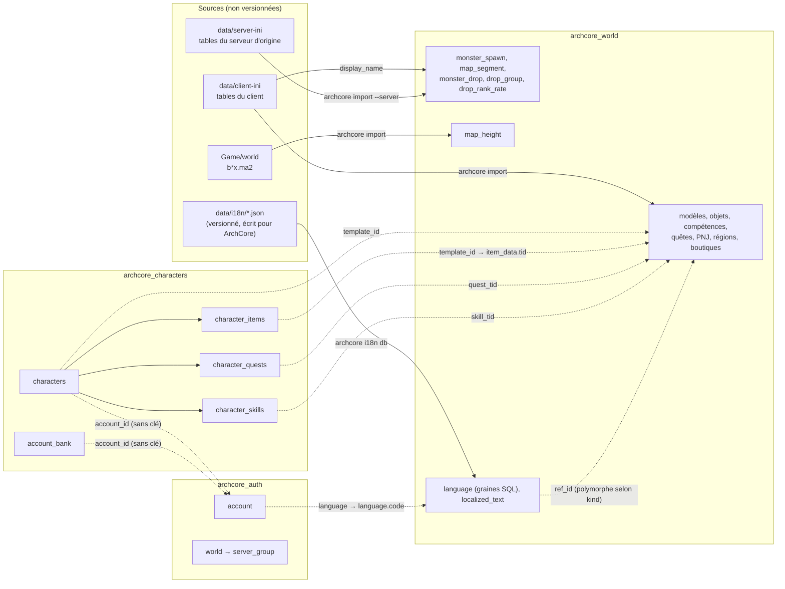
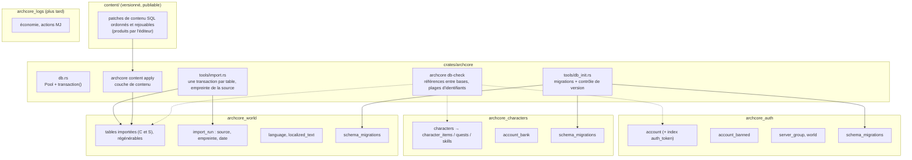

# Audit de l'architecture de la base de données d'ArchCore

*Audit du 2026-10-20, inspiré des principes de VMaNGOS (émulateur libre de World of Warcraft 1.12.1).
C'est un audit seulement : aucun code, aucun schéma ni aucune base n'a été modifié.*

| | |
|---|---|
| État `Core` | `origin/Core` 71bb717 (worktree `ArchCore-core`) |
| État `db-vmangos` | 38316a9 (worktree `ArchCore-db`), construit sur `Core` 2df4dbf ; `Core` n'a ajouté depuis que la feuille de route du wiki |
| Référence VMaNGOS | `HomeCraft/Server/Database/sql/{logon,characters,logs,mangos}.sql` (lus, ni copiés ni cités) |
| Méthode | Lecture des schémas `sql/*.sql`, de `db.rs`, de `tools/db_init.rs`, de `tools/import.rs`, et de chaque requête SQL du code (124 appels au pool relevés dans `crates/archcore/src`, hors `db.rs`) |
| Limites | L'instance MariaDB locale ne tournait pas pendant l'audit (connexion refusée sur 3306). Aucune requête n'a donc été exécutée, même en lecture : rien n'a été mesuré, et les nombres de lignes viennent du wiki (`FR-Base-de-donnees.md`). |

---

## 0. Synthèse

**Verdict sur `db-vmangos` : je recommande de ne pas la fusionner telle quelle, et de reprendre plutôt
les principes de VMaNGOS sans ses noms.**

La branche `db-vmangos` est presque entièrement un **renommage** : 24 tables et environ 95 colonnes
prennent un nom de VMaNGOS. Elle n'apporte qu'un seul changement de structure, la table
`account_banned`, qui remplace la colonne `account.banned_until`. Elle est soignée (scripts rejouables,
renommages conditionnels, validée par les 17 scénarios `archcore sim` sur des copies), mais :

1. **Elle ne reprend aucun des principes qui font la solidité de VMaNGOS** : migrations versionnées avec
   une table `migrations` par base, contrôle de cohérence au démarrage, contenu du monde géré comme une
   source versionnée, sauvegarde d'un joueur en une transaction, base de journaux à part. Les points faibles
   relevés plus bas (aucune transaction, import non atomique, aucune trace de version du schéma) sont
   les mêmes dans les deux états.
2. **Les noms de VMaNGOS induisent en erreur dans ArchLord.** `item_template` désigne une autre table
   dans chaque branche (le modèle client dans `Core`, les caractéristiques serveur dans `db-vmangos`).
   `creature_template` contient aussi les modèles des joueurs. `spell` désigne les compétences.
   `creature.guid` est une section de `npc.ini`, pas un identifiant attribué par le serveur.
   `sha_pass_hash` désigne chez VMaNGOS une autre empreinte que le SHA-256 d'ArchCore. Les noms d'origine
   (`tid`, `npc_spawn`, `item_data`) correspondent, eux, aux fichiers du client que les contributeurs
   ouvrent pour vérifier une donnée.
3. **Le code Rust garde les noms ArchLord** et ajoute des alias en SQL
   (`SELECT entry AS tid, buy_price AS npc_price…`). Deux vocabulaires coexistent donc pour chaque donnée.
4. **La migration va dans un seul sens et touche une base partagée.** `archcore_world` sert à la fois au
   serveur principal (11002/11008) et à l'instance de test (11102/11108). Lancer `db-init` de
   `db-vmangos` pour l'instance de test convertirait donc aussi le monde du serveur principal, que le
   binaire `Core` ne sait plus lire (voir § 8).

Ce que je recommande à la place, du moins risqué au plus structurant (détail au § 9) :

- rendre atomiques les opérations économiques (échange, banque, piles d'objets) et l'import, sans toucher
  au schéma ;
- ajouter une table `schema_migrations` par base, des migrations numérotées et un contrôle de version au
  démarrage ;
- reprendre de `db-vmangos` l'idée d'`account_banned`, sous forme de migration additive, et sa technique de
  scripts rejouables ;
- donner des identifiants stables aux lignes importées qui n'en ont pas, et séparer le contenu importé du
  contenu écrit par ArchCore (prérequis de l'éditeur graphique prévu dans la feuille de route) ;
- documenter les équivalences avec VMaNGOS dans le wiki au lieu de renommer : on garde l'aide pour les
  contributeurs venus de VMaNGOS, sans les faux amis.

Si l'utilisateur tient malgré tout aux noms VMaNGOS, la fusion ne devrait venir qu'**après** le système
de migrations et le contrôle de version, et après avoir séparé le `archcore_world` de chaque instance
(étape 8 du plan).

---

## 1. Architecture actuelle

### 1.1 Moteur et accès

- **MariaDB**, moteur InnoDB partout, `utf8mb4`. Le script `db/start-mariadb.cmd` lance
  `C:\Program Files\MariaDB 13.0\bin\mariadbd.exe` sur le port 3306.
- **Pilote `mysql_async`**, enveloppé dans `crates/archcore/src/db.rs` : un `Pool` par base (`auth`,
  `characters`, `world`), au plus `Database.ConnectionLimit` connexions (8 par défaut). Il offre quatre
  méthodes : `rows`, `first`, `exec` (rend `last_insert_id`) et `batch`. Chaque appel prend une connexion
  du pool. **Le pool n'offre aucun moyen d'ouvrir une transaction** : aucun `start_transaction`,
  `BEGIN` ni `FOR UPDATE` dans le dépôt.
- **Lecture tolérante** : `db::col` (`db.rs:88`) rend la valeur par défaut quand une colonne est NULL,
  d'un type inattendu **ou absente**. Associée aux `SELECT *` (`character.rs`, `login.rs`,
  `world/mod.rs:330`), elle transforme une colonne renommée ou manquante en zéros silencieux au lieu d'une
  erreur.
- **SQL écrit dans le code**, sous forme de chaînes paramétrées (`?`) réparties dans chaque module de
  `world/`. Il n'y a ni ORM ni couche de dépôts. Une seule requête est construite par `format!`, avec des
  marques de paramètres (`character.rs:188`), et `import.rs:221` met en forme un nom de table interne.
  Aucune injection n'est possible depuis le réseau.

### 1.2 Schéma (`sql/`) et création (`archcore db-init`)

`tools/db_init.rs` crée les trois bases (`CREATE DATABASE IF NOT EXISTS`), puis exécute chaque fichier
`sql/*.sql` d'un seul bloc (plusieurs instructions par requête). La base cible de chaque fichier est
**codée en dur** (`db_init.rs:16`) : un `005_*.sql` serait ignoré (« base cible inconnue ») tant que le
code n'est pas modifié. Les scripts sont rejouables (`CREATE TABLE IF NOT EXISTS`, `INSERT IGNORE`,
`ADD COLUMN IF NOT EXISTS`). **Rien n'enregistre ce qui a été appliqué**, et le serveur ne vérifie pas la
version du schéma au démarrage.

| Base | Fichier | Tables (`Core`) | Nom dans `db-vmangos` |
|---|---|---|---|
| `archcore_auth` | `001_auth.sql` | `account`, `server_group`, `world` | `account` (colonnes renommées), `realm_group`, `realmlist`, + `account_banned` |
| `archcore_characters` | `002_characters.sql` | `characters`, `character_items`, `account_bank`, `character_quests`, `character_skills` | `characters`, `item_instance`, `account_bank`, `character_queststatus`, `character_spell` |
| `archcore_world` | `003_world.sql` | 23 tables (§ 2.5) | 23 tables renommées (`creature_template`, `creature`, `creature_spawn`, `npc_vendor`…) |
| `archcore_world` | `004_locale.sql` | `language`, `localized_text` | `language`, `locales_text` |

Clés étrangères existantes, dans `archcore_characters` seulement : `character_items`,
`character_quests` et `character_skills` → `characters (id) ON DELETE CASCADE`. Dans `archcore_auth` :
`world.group_id` → `server_group.id`. Il n'y en a aucune dans `archcore_world`.

### 1.3 Import (`archcore import`)

`tools/import.rs` lit trois sources et remplit `archcore_world` :

1. `data/client-ini/` : les tables déchiffrées du client (CP949, converties en UTF-8) ;
2. `Game/world/b*x.ma2` : la géométrie du sol du client (`map_height`) ;
3. `data/server-ini/` (ou `--server`) : les tables du serveur d'origine (apparitions, `node_data`, butin).

Chaque table passe par `replace()` (`import.rs:219`) : un `DELETE FROM table`, puis des insertions par
lots de 500, **chacune sur sa propre connexion et sans transaction**. Si l'import s'interrompt, la table
reste vide ou incomplète. Plusieurs identifiants ne sont que des **numéros d'ordre de l'import** :
`monster_spawn.id`, `monster_drop.id` et `resurrection_point.id`.

### 1.4 Persistance à l'exécution

Le serveur monde (`world/mod.rs`) garde tout son état dans un `WorldState` protégé par **un seul**
`tokio::sync::Mutex` (`world/mod.rs:212`, verrouillé à chaque paquet en `:255`). Les requêtes SQL sont
attendues **pendant que ce verrou est tenu**. Les paquets de tous les joueurs passent donc un par un : il
n'y a pas d'écritures concurrentes dans le monde, mais un aller-retour SQL lent bloque tout le monde (non
mesuré).

| Moment | Ce qui est lu ou écrit | Code |
|---|---|---|
| Démarrage | Tout le contenu du monde chargé en mémoire : modèles, croissance, objets, boutiques, carte, butin, régions, compétences, quêtes, expérience par niveau, langues et textes | `server.rs:30-48`, `*::load` |
| Entrée en jeu | compte (par `auth_token`), personnage, inventaire, banque du compte (créée au besoin), quêtes, compétences, langue | `world/mod.rs:317-424` |
| Chaque action | écriture immédiate, une requête par changement : argent, objets, quêtes, compétences, niveau et expérience, nom | `items.rs`, `bank.rs`, `trade.rs`, `quests.rs`, `skills.rs`, `combat.rs:414,436` |
| Toutes les 60 s et au départ | position des joueurs qui ont bougé | `presence.rs:28,264,274` |
| Jamais | PV, PM et PE (écrits seulement à la création), `skill_points`, `cash`, `durability`, interdictions de discussion, taux du serveur (`/SetExp`…), monstres, objets au sol, groupes, échanges en cours | — |

### 1.5 Carte des dépendances

Les flèches en pointillé sont des **références entre bases**. Aucune clé étrangère ne les garantit, et
aucun contrôle ne les vérifie, ni au démarrage ni après un import.

**Identifiants transmis au client** (contrainte de compatibilité) : le CID d'un joueur est
`characters.id` ; celui d'un PNJ est `0x4000_0000 + npc_spawn.id` (`npcs.rs:27,174`) ; celui d'un monstre
vient d'une plage `0x5000_0000`, attribuée en mémoire. L'IID d'un objet est `character_items.id`, rangé
en `u32` côté Rust bien que la colonne soit un `BIGINT`, alors que les plages `0x2000_0000` (boutiques) et
`0x3000_0000` (objets au sol) sont réservées (`items.rs:48`, `loot.rs:28`). Implicitement, il faut donc
`characters.id < 0x4000_0000` et `character_items.id < 0x2000_0000`.

---

## 2. Le modèle de données par domaine

Origine : **C** = fichier du client, **S** = table du serveur d'origine, **A** = écrit par ArchCore
(graines SQL, `data/i18n`), **J** = état des joueurs.

### 2.1 Authentification et comptes — `archcore_auth`

| Table | Origine | Lue / écrite par |
|---|---|---|
| `account` | J | `login.rs:229` (connexion, bannissement), `:441` (clé d'entrée), `world/mod.rs:321` (entrée par clé), `locale.rs` (langue), `db_init.rs` (`--account`) |
| `server_group`, `world` | A (graine `001_auth.sql`, adresse `127.0.0.1:11008` en dur) | liste des mondes (`login.rs`) |

À noter : `auth_token` n'a **ni index ni contrainte d'unicité**. Il est tiré au hasard entre 1 et
2³¹ (`login.rs:439`) et **n'est jamais effacé** après usage. Le mot de passe est un SHA-256 sans sel
(`login.rs:52,233`). Les bannissements ne sont que lus : aucune commande ne les écrit.

### 2.2 Personnages et progression — `archcore_characters` + `archcore_world`

| Table | Origine | Remarques |
|---|---|---|
| `characters` | J | création `login.rs:380`, suppression logique `:418` (`deleted_at`, nom → `nom#id`), niveau et expérience `combat.rs`, position `presence.rs`, argent (plusieurs modules), nom (`/rename_char`) |
| `character_template` | C `charactertemplate.ini` | modèles des joueurs, des PNJ et des monstres ; `raw` JSON |
| `character_data_table` | C `CharacterDataTable.txt` | JSON ; caractéristiques des monstres, noms des modèles jouables |
| `growup_factor` | C `GrowUpFactor.txt` | croissance par niveau (`character.rs`) |
| `level_exp` | C `LevelUpExp.txt` | `server.rs:43` |
| `login_char_pos` | C `logincharpos.ini` | importée ; aucune lecture dans le code (les départs viennent de `world.conf`) |

### 2.3 Inventaire, équipement, objets et exemplaires

| Table | Origine | Remarques |
|---|---|---|
| `character_items` | J | un exemplaire d'objet ; `status` 0 inventaire, 1 équipé, 2 banque ; grille `layer/row_idx/col_idx` ; `durability` jamais écrite |
| `item_data` | C `itemdatatable.txt` | caractéristiques serveur (prix, piles, `raw`) → `ItemCatalog` |
| `item_template` | C `itemtemplateentry.ini` | modèle côté client ; lu seulement par `/create` (`world/mod.rs:587`) |

Les objets en banque appartiennent au **personnage qui les a déposés** (`character_id`), mais la banque
est commune au compte (`bank.rs:58-63`, jointure sur `characters.account_id`). Une suppression physique
de ce personnage effacerait donc des objets de la banque du compte (`ON DELETE CASCADE`). Ce n'est pas un
problème aujourd'hui, la suppression étant logique, mais le piège est latent.

### 2.4 Compétences, classes, caractéristiques, combat

| Table | Origine | Remarques |
|---|---|---|
| `character_skills` | J | apprentissage et amélioration (`skills.rs`) ; « Normal Attack » implicite |
| `skill_template` | C `SKILLTEMPLATE.ini` | noms ; lue par `locale.rs` et `i18n.rs` |
| `skill_spec`, `skill_level` | C `SKILL_SPEC.txt`, `SKILL_CONST.txt` | JSON → `SkillCatalog` |
| `character_template`, `character_data_table`, `growup_factor` | C | statistiques et dégâts (voir 2.2) |

### 2.5 Monde, créatures, PNJ, apparitions, quêtes, butin

| Table | Origine | Remarques |
|---|---|---|
| `npc_spawn` | C `npc.ini` | `id` = section `[N]`, stable, et base du CID |
| `monster_spawn` | **S** `spawndatatable` + `spawninstancetable`, avec `display_name` venant de **C** | `id` = ordre d'import |
| `map_segment` | **S** `world/node_data` | sol infranchissable, régions |
| `map_height` | C `Game/world/b*x.ma2` | hauteur du sol |
| `monster_drop`, `drop_group`, `drop_rank_rate` | **S** | `monster_drop.id` = ordre d'import |
| `quest_template`, `quest_group` | C | JSON ; `quest_group` garde les listes en JSON |
| `region_template` | C `RegionTemplate.ini` | sûreté |
| `resurrection_point` | C `obj*.ini` (événement 19) | `id` = ordre d'import |
| `client_table` | — | **ni écrite ni lue** par le code : table morte |

### 2.6 Économie, banque, échange, autres systèmes d'ArchLord

| Table | Origine | Remarques |
|---|---|---|
| `characters.money`, `.bank_money`, `.cash` | J | `bank_money` ne sert plus qu'à amorcer `account_bank` ; `cash` est lu et envoyé, jamais écrit |
| `account_bank` | J | une ligne par compte, **sans clé étrangère** (le compte est dans une autre base) |
| `npc_trade_list` | C `npctradeitemlist.txt` | boutiques |
| échange entre joueurs | — (mémoire) | `trade.rs` ; seul le résultat est écrit (§ 5.1) |
| groupes | — (mémoire) | `party.rs`, rien n'est persisté |

### 2.7 Journaux, configuration, administration

- **Journaux** : il n'y en a aucun en base. Les échanges, les ventes, la banque et les commandes MJ ne
  laissent qu'une ligne de journal texte (`info!`).
- **Configuration** : les fichiers `config/*.conf`. Le seul réglage rangé en base est l'adresse du monde
  (`world.address`), qui est en dur dans `001_auth.sql`. La mémoire du projet indique qu'elle est corrigée
  à la main pour chaque instance de test.
- **Administration** : les commandes MJ de `gm.rs`, avec un niveau requis par commande, sont définies dans
  le code. Elles n'écrivent en base qu'à travers les modules de jeu (`/money`, `/level`,
  `/rename_char`, `/questreset`). Les taux (`/SetExp`…) et les interdictions de discussion restent en
  mémoire.
- **Langues** : `language`, avec des graines A, et `localized_text`, rempli depuis `data/i18n` par
  `archcore i18n db`.

---

## 3. Les principes de VMaNGOS utiles à ArchCore

| Principe de VMaNGOS | Ce que fait ArchCore aujourd'hui | À reprendre ? |
|---|---|---|
| Bases séparées : comptes, personnages, monde, **journaux** | Trois bases, la séparation entre monde et personnages est déjà nette | Oui pour une base de journaux, plus tard (R11) |
| **Table `migrations` dans chaque base** (logon, characters, logs, mangos), avec une liste horodatée des scripts appliqués | Rien : `db-init` rejoue tout, sans trace | **Oui**, c'est le principe le plus utile (R4) |
| Identifiants stables (`entry` pour un modèle, `guid` pour une instance), jamais renumérotés | Les TID, venus du client, sont stables ; trois tables importées ont des identifiants d'ordre | Oui, pour les tables qui n'en ont pas (R7) |
| Intégrité **contrôlée par le serveur au démarrage** : aucune clé étrangère (0 dans les quatre dumps, des tables majoritairement MyISAM : 46 sur 55 dans `characters.sql`) ; le serveur signale et ignore les références invalides | InnoDB et clés étrangères à l'intérieur de `archcore_characters`, rien entre les bases | Garder les clés étrangères d'ArchCore, **et** ajouter le contrôle au démarrage pour les références entre bases (R8) |
| Le contenu du monde est une **source versionnée**, corrigée par des migrations | Le contenu est **régénéré** depuis les fichiers du client par un import destructif | Oui, sous forme d'une couche de contenu appliquée après l'import (R9) |
| Sauvegarde d'un joueur groupée dans une transaction | Une écriture par action, sans transaction | Oui pour les opérations à plusieurs écritures (R1) |
| Textes traduits par entité | `localized_text` (`kind`, `ref_id`, `lang`) | Déjà adapté : une table unique suffit à ArchCore |

**À ne pas reprendre**, parce que ce sont des mécaniques de World of Warcraft : les colonnes de
progression du contenu par version (patch), les masques race/classe/faction, les tables de factions et de
réputation, `gossip_menu`, les instances et les champs de bataille, le modèle `character_inventory`
(sacs de WoW). ArchLord a sa propre grille à trois dimensions, déjà rangée dans `character_items`.

---

## 4. Définitions statiques et état modifiable

### 4.1 La séparation existe déjà dans les bases

- `archcore_world` ne contient que des définitions (lues au démarrage) et des textes. Seules deux tables
  sont écrites à l'exécution, et seulement par des outils : `localized_text` (par `archcore i18n db`) et
  `language` (par les graines).
- `archcore_characters` et `archcore_auth` contiennent l'état modifiable.
- Un seul mélange : `characters.bank_money` est un reste de l'ancien modèle, et `account_bank` fait
  désormais foi (`world/mod.rs:348`).

### 4.2 Ce qui manque : l'origine de chaque donnée statique

| Origine | Tables | Publiable ? |
|---|---|---|
| Fichiers du client (propriété de l'éditeur) | `character_template`, `character_data_table`, `level_exp`, `growup_factor`, `login_char_pos`, `item_template`, `item_data`, `skill_*`, `quest_*`, `npc_spawn`, `npc_trade_list`, `region_template`, `resurrection_point`, `map_height` | **Non** : on les régénère chez chacun avec `archcore import` |
| Tables du serveur d'origine (jamais versionnées, voir `.gitignore`) | `monster_spawn` (avec le `display_name` du client), `map_segment`, `monster_drop`, `drop_group`, `drop_rank_rate` | **Non**, et leur absence doit rester gérée (`import.rs` saute déjà ces tables sans `--server`) |
| Écrites par ArchCore | graines `language`, `server_group`, `world` ; `data/i18n/*.json` → `localized_text` | Oui, ce sont déjà des fichiers du dépôt |
| État des joueurs | `archcore_auth`, `archcore_characters` | Jamais dans une release |

**Conséquence pour une release** : une sauvegarde (`mariadb-dump`) de `archcore_world` redistribuerait les
données de l'éditeur et celles du serveur d'origine. Ce dépôt ne doit jamais en publier. Une release
contient le binaire, `sql/`, `config/*.dist` et `data/i18n` ; le monde est construit sur place par
`archcore import`. Un futur contenu propre à ArchCore (corrections, apparitions ajoutées, PNJ créés avec
l'éditeur) devra être rangé **à part** pour rester publiable (R9). À vérifier : les fichiers `data/i18n`
déjà versionnés contiennent des noms tirés du client, en clé de traduction (question ouverte n° 6).

---

## 5. Transactions, intégrité, index, performances, concurrence

### 5.1 Constats (vérifiés dans le code)

| # | Constat | Preuve | Gravité |
|---|---|---|---|
| F1 | **Aucune transaction.** Plusieurs opérations écrivent en plusieurs requêtes indépendantes. Si une requête échoue au milieu, la base et la mémoire divergent : l'objet ou l'or est perdu, ou se trouve des deux côtés. | échange : `trade.rs:294-340` (N déplacements d'objets, puis 2 écritures d'argent, les inventaires en mémoire étant déjà modifiés) ; banque : `bank.rs:279-280` (argent du personnage puis du compte), `:184-185`, `:234-235` (fusion de piles) ; inventaire : `items.rs:381-391` (suppression **puis** ajout à la pile cible), `:395-410` (réduction **puis** insertion de la nouvelle pile) | Haute |
| F2 | **Écritures de valeurs absolues tirées de la mémoire** (`SET money = ?`), sans garde contre deux sessions du même compte : `game_enter` ne vérifie pas que le compte ou le personnage est déjà en jeu, et la clé d'entrée reste valable. Chaque session a sa propre copie de la banque du compte. | `world/mod.rs:317-424`, `bank.rs:280`, `login.rs:439-441` | Haute si ce cas est reproductible (**plausible, à tester**, voir § 10) |
| F3 | `account.auth_token` sans index ni `UNIQUE`, jamais effacé. Chaque entrée en jeu parcourt toute la table `account`, et deux comptes peuvent avoir la même clé (rare). | `001_auth.sql`, `world/mod.rs:321` | Moyenne |
| F4 | `col()` tolérant + `SELECT *` : un écart de schéma donne des zéros au lieu d'une erreur. | `db.rs:88`, `character.rs`, `world/mod.rs:330` | Moyenne (grave pendant une migration) |
| F5 | Import non atomique : `DELETE` puis lots, sur des connexions distinctes. Une interruption laisse la table vide. | `import.rs:219-226` | Moyenne |
| F6 | `archcore i18n db` efface toutes les lignes `(lang, kind)` des six sortes qu'il traite, y compris celles saisies à la main pour la même sorte. Pire : si un `SELECT` source échoue, `unwrap_or_default()` donne une liste vide, et les lignes de cette sorte sont **effacées quand même**. | `i18n.rs:79-99` | Moyenne |
| F7 | Suppression d'un personnage : `CONCAT(name, '#', id)` peut dépasser `VARCHAR(48)`, puisque la création admet jusqu'à 48 caractères. En mode strict, l'`UPDATE` échoue. | `login.rs:356,418` | Basse |
| F8 | Création de personnage : `SELECT` du nom puis `INSERT`. L'index `UNIQUE` protège, mais un doublon simultané remonte comme une erreur générique, pas comme `NAME_TAKEN`. | `login.rs:360-397` | Basse |
| F9 | Références entre bases non vérifiées (§ 1.5). Un objet dont le TID disparaît d'`item_data` après un réimport reste en inventaire sans définition. | — | Moyenne |
| F10 | Plages d'identifiants implicites (`characters.id < 0x4000_0000`, `character_items.id < 0x2000_0000`), que ni le schéma ni le démarrage ne vérifient. | `npcs.rs:27`, `items.rs:48` | Basse aujourd'hui |
| F11 | `archcore_world` est partagée par le serveur principal et l'instance de test : toute migration du monde touche les deux. | mémoire du projet (`archcore-serveur-de-test`) | Haute pour la migration |
| F12 | Colonnes et tables sans usage : `client_table`, `login_char_pos` (importée, non lue), `skill_points`, `cash`, `durability` ; PV, PM et PE écrits seulement à la création. | grep sur le code | Basse (clarté) |

### 5.2 Index et performances

Il n'y a **aucune preuve d'un problème de performance**, et rien n'a pu être mesuré. Ce que montre le
code :

- Les requêtes fréquentes portent sur `archcore_characters` et sont couvertes : clé primaire
  (`WHERE id = ?`), `ix_item_character` (inventaire), `ix_character_account` (liste des personnages,
  banque), `uq_character_name`. Seule exception : `account.auth_token` (F3).
- Les tables du monde sont lues **entièrement**, une seule fois au démarrage. Leurs index secondaires
  (`ix_npc_xz`, `ix_ms_xz`, `ix_ct_race_class`, `ix_md_monster`, `ix_rp_region`) ne servent pas
  aujourd'hui. Ils ne coûtent presque rien et serviront à l'éditeur : à garder.
- Le seul vrai sujet de latence possible, c'est le verrou global tenu pendant les requêtes (§ 1.4). Avant
  de changer quoi que ce soit, il faut **mesurer** : journaliser la durée des requêtes au-delà d'un seuil
  (R12).

---

## 6. Ce qui reste en SQL, ce qui reste en mémoire (Rust)

| En SQL (fait foi) | En mémoire seulement (Rust) | À décider |
|---|---|---|
| comptes, bannissements, mondes | sessions, clés de chiffrement | interdictions de discussion (`chat_bans`) : perdues au redémarrage |
| personnages : niveau, expérience, argent, position (toutes les 60 s et au départ) | position exacte entre deux sauvegardes, destination, vue | PV, PM et PE : aujourd'hui remis aux valeurs enregistrées à la création, bornées au maximum |
| exemplaires d'objets, banque, quêtes, compétences | boutiques ouvertes (IID `0x2…`), objets au sol (`0x3…`), échange en cours | taux du serveur (`/SetExp`…) : perdus au redémarrage |
| définitions du monde (source : l'import, plus tard la couche de contenu) | catalogues chargés au démarrage, monstres vivants et leur IA, groupes, effets et délais | réapparition des boss après un redémarrage (VMaNGOS la persiste, pas ArchCore) |
| textes localisés | — | — |
| (plus tard) journaux de l'économie et des actions MJ | — | — |

Le principe du code actuel est le bon : **lire le contenu une fois et le garder en mémoire, écrire l'état
des joueurs tout de suite**. Il faut le garder. Ce qui manque, c'est l'**atomicité** des écritures liées
entre elles, pas une couche de cache ou d'écriture différée : celle-ci ajouterait de la complexité sans
bénéfice démontré.

---

## 7. Architecture proposée

### 7.1 Vue logique

### 7.2 Groupes de tables et relations recommandés

On **garde les noms actuels** (ceux de `Core`), alignés sur les fichiers d'ArchLord, et on ajoute
seulement ce qui apporte quelque chose :

| Groupe | Tables | Relations et règles |
|---|---|---|
| Comptes | `account`, **`account_banned`** (idée reprise de `db-vmangos`), `server_group`, `world`, `schema_migrations` | `account_banned.account_id → account.id` (clé étrangère possible, même base) ; index (unique et nullable) sur `account.auth_token` |
| Personnages | `characters`, `character_items`, `character_quests`, `character_skills`, `account_bank`, `schema_migrations` | clés étrangères actuelles conservées ; références vers `archcore_auth` et `archcore_world` vérifiées par `db-check` et au démarrage, **pas** par des clés étrangères entre bases (elles bloqueraient le `DELETE` de l'import et lieraient les bases entre elles) |
| Monde importé | les 23 tables actuelles, `import_run` | identifiants stables partout (R7) ; aucune écriture à l'exécution |
| Textes | `language`, `localized_text` | ajouter une colonne `source` (`import` / `manual`) pour que `i18n db` ne remplace que ses propres lignes (R10) |
| Contenu ArchCore | fichiers `content/*.sql`, appliqués après l'import | chaque fichier est rejouable (`INSERT … ON DUPLICATE KEY UPDATE`, ou `UPDATE` ciblé par clé stable) |
| Journaux (plus tard) | `archcore_logs` : échanges, ventes, banque, commandes MJ | écriture seule, sans clé étrangère, avec index par personnage et par date |

Je n'ajoute **pas** de table de jonction pour remplacer le JSON de `quest_group` ni les colonnes `raw` :
le JSON reproduit fidèlement les fichiers du client, et le code le lit déjà. Il vaut mieux les
normaliser une fois que l'éditeur en aura besoin, champ par champ.

### 7.3 Migrations (repris de VMaNGOS, adapté)

- `sql/001…004` deviennent la **base de référence** (*baseline*).
- Les changements suivants vont dans `sql/migrations/<base>/<AAAAMMJJHHMM>_<sujet>.sql`. La base cible se
  lit dans le chemin du fichier : plus de table codée en dur dans `db_init.rs`.
- Chaque base reçoit une table `schema_migrations (id, applied_at, checksum)`. `db-init` applique, dans
  l'ordre, les migrations absentes, et enregistre chacune après son succès.
- Le serveur connaît, à la compilation, la dernière migration attendue pour chaque base. **Au démarrage,
  il refuse de partir** si une base est en retard ou en avance, avec un message clair. Cela neutralise F4
  pendant les transitions.
- Les migrations sont additives par défaut. Un renommage ou une suppression passe par deux versions :
  ajout, double lecture, puis retrait.

### 7.4 Ce que cette architecture facilite

| Besoin | Comment |
|---|---|
| Contributeurs | un nom = le fichier ArchLord d'origine ; une page du wiki « Équivalences avec VMaNGOS » ; une migration par changement, facile à relire |
| Mises à jour automatiques de la base | `db-init` applique les migrations en attente ; le serveur refuse une base non à jour |
| Tests | base jetable (`archcore_ci_*`) créée par `db-init`, puis tests d'intégration et scénarios `sim` |
| Éditeur graphique (feuille de route) | identifiants stables, contenu ArchCore séparé de l'import, SQL produit = patch de `content/` ; `db-check` valide avant de publier |
| Nouvelles fonctions d'ArchLord (guildes, siège, boutique en argent réel `cash`…) | une migration par fonction, dans la bonne base ; les écritures liées passent par `transaction()` |

---

## 8. Risques de migration et compatibilité ascendante

| Risque | Détail | Parade |
|---|---|---|
| Base convertie, binaire `Core` | Sur une base passée par `db-vmangos`, le code `Core` échoue sur les colonnes renommées (`account_id`, `password_hash`…). Les `SELECT *` lus par `col()` rendent des zéros sans erreur. Un `db-init` de `Core` recrée en plus, vides, les anciennes tables à côté des nouvelles (`character_items`, `item_data`…). | contrôle de version au démarrage (§ 7.3) ; ne jamais mélanger deux binaires sur une même base |
| `archcore_world` partagée (F11) | Migrer le monde pour l'instance de test migre aussi celui du serveur principal (11002). | une base monde par instance (`archcore_test_world`), ou une copie avant tout essai |
| Migration interrompue | Les scripts de `db-vmangos` sont rejouables, sauf un cas : une coupure entre les deux premières instructions de `003_world.sql` (`item_template` → `item_display_info`, puis `item_data` → `item_template`) bloque la reprise, qui demande alors une correction à la main. | instructions de ce genre regroupées dans une migration enregistrée, et sauvegarde préalable |
| Suppression de `banned_until` (`db-vmangos`) | Les données sont recopiées dans `account_banned` avant le `DROP COLUMN`, mais un retour en arrière demande la sauvegarde. | version additive : garder la colonne, lire les deux, retirer plus tard |
| Identifiants transmis au client | `characters.id`, `npc_spawn.id` (CID) et `character_items.id` (IID) partent sur le réseau. Les renuméroter casserait les sessions et les AddOns. | ne jamais renuméroter ; stabiliser seulement les identifiants internes (R7) |
| Client ArchLord et ArchRust | Aucun client ne lit la base, et `ArchRust` ne contient pas de SQL. La compatibilité tient au protocole et aux identifiants. | rien à changer côté client |
| Documentation et habitudes | Le wiki, les scripts personnels et les requêtes MJ citent les noms actuels. | mise à jour du wiki dans la même migration |

Exigences de compatibilité ascendante proposées :

1. Une base créée par la release v0.2.0 doit pouvoir passer à la suivante par `db-init` seul.
2. Un binaire refuse une base qu'il ne connaît pas, au lieu de la lire de travers.
3. Aucune migration ne supprime de données de joueurs sans une version intermédiaire et une sauvegarde
   documentée.
4. Le contenu importé reste entièrement régénérable depuis les fichiers du client.

---

## 9. Recommandations et plan de migration par étapes

Les étapes vont de la moins risquée à la plus structurante. Aucune n'oblige à une migration
destructive.

| Étape | Rec. | Quoi | Raison | Bénéfice | Coût | Risque |
|---|---|---|---|---|---|---|
| 0 | R0 | Script de sauvegarde (`mariadb-dump` des trois bases) et procédure de copie vers `archcore_audit_*` pour les essais | prérequis de tout le reste | retour en arrière garanti | très faible | nul |
| 1 | R1 | `Pool::transaction()` dans `db.rs`, puis échange, banque, fusion et séparation de piles dans une transaction ; mise à jour de la mémoire **après** la validation | F1 | plus de perte ni de duplication d'or ou d'objets sur une erreur SQL | faible (≈ 50 lignes + reprise de 6 fonctions) | faible ; couvert par `sim trade`, `bank`, `bag`, `shop` |
| 1 | R2 | Une session par compte dans le monde ; clé d'entrée effacée une fois utilisée ; écritures relatives et conditionnelles pour l'argent (`SET money = money - ? WHERE money >= ?`) | F2, F3 | ferme une piste de duplication | faible | faible : vérifier qu'aucun client ne réutilise la clé (reconnexion) |
| 1 | R3 | Import : une transaction par table (`DELETE` + lots) ; `i18n db` s'arrête si un `SELECT` source échoue | F5, F6 | plus de monde à moitié vide ni de traductions effacées | très faible | nul |
| 2 | R4 | `schema_migrations` + base de référence 001-004 + contrôle de version au démarrage ; base cible lue dans le chemin des migrations | § 7.3, F4 | mises à jour automatiques, erreurs claires | moyen (≈ 200 lignes) | faible si la base de référence est reconnue sans rien modifier |
| 3 | R5 | Migrations additives : index `UNIQUE` (nullable) sur `auth_token` ; `account_banned`, en gardant la lecture de `banned_until` pendant une version | F3, idée de `db-vmangos` | entrée en jeu indexée, historique des bannissements | faible | faible |
| 3 | R6 | Une base monde par instance (`archcore_test_world`) | F11 | les essais ne touchent plus le serveur principal | très faible (config + un import) | nul |
| 4 | R7 | Identifiants stables pour `monster_spawn` (clé = nom du point + rang de la position), `monster_drop` (monstre + objet), `resurrection_point` (fichier + objet) | § 1.3 | l'éditeur et la couche de contenu peuvent viser une ligne d'un réimport à l'autre | moyen | faible : ce sont des tables régénérées, aucune donnée de joueur ne pointe vers elles (`monster_name` utilise le `tid`) |
| 5 | R8 | `archcore db-check` + contrôle au démarrage : TID des objets, quêtes, compétences et modèles des personnages, comptes des personnages, langues, plages d'identifiants | F9, F10, principe de VMaNGOS | erreurs de contenu repérées avant d'arriver en jeu | moyen | nul (lecture seule) |
| 6 | R9 | Couche de contenu `content/*.sql`, appliquée après `import` ; table `import_run` (source, empreinte, date) | § 4.2, éditeur | contenu ArchCore publiable, survit aux réimports | moyen à élevé | moyen : définir l'ordre et les conflits import/patch |
| 6 | R10 | `localized_text.source` (`import`/`manual`) ; `i18n db` ne remplace que `import` | F6 | les traductions saisies à la main survivent | faible | faible |
| 7 | R11 | Base `archcore_logs` (échanges, ventes, banque, MJ) | § 2.7, principe de VMaNGOS | traçabilité de l'économie, enquêtes après un abus | moyen | faible (écriture seule) |
| 7 | R12 | Mesure : journaliser les requêtes de plus de N ms, et le temps de verrou par paquet | § 5.2 | décider sur des preuves | très faible | nul |
| 8 | R13 | *(Facultatif, décision de l'utilisateur)* noms VMaNGOS de `db-vmangos`, rejoués comme une migration enregistrée | familiarité des contributeurs VMaNGOS | lecture plus facile pour eux | élevé (code, wiki, double vocabulaire) | moyen à élevé (§ 8) ; **non recommandé**, remplacé par une page d'équivalences dans le wiki |

Petits correctifs à faire en passant (coût et risque très faibles) : borner le nom avant la suppression
logique (F7) ; rendre `NAME_TAKEN` sur une violation d'unicité (F8) ; supprimer ou documenter
`client_table` et `login_char_pos` (F12) ; prendre l'adresse du monde dans la configuration plutôt que
dans `001_auth.sql`.

---

## 10. Tests avant et après chaque migration

**Avant chaque étape** (sur l'instance de test ou une copie, jamais sur 11002/11008) :

1. `mariadb-dump` des bases touchées.
2. Instantané du schéma : `information_schema.COLUMNS`, `STATISTICS` et `KEY_COLUMN_USAGE`, exportés pour
   comparaison.
3. Nombre de lignes et `CHECKSUM TABLE` de chaque table touchée.
4. `cargo test` (108 tests unitaires aujourd'hui) et les 17 scénarios `archcore sim`.

**Après chaque étape** :

1. Mêmes nombres de lignes (et mêmes sommes de contrôle, pour une migration qui ne doit pas changer les
   données).
2. Comparaison des schémas : seuls les changements prévus apparaissent.
3. `db-init` rejoué **deux fois** : la seconde passe ne change rien (idempotence) ;
   `schema_migrations` est à jour.
4. Le binaire de la version précédente **refuse** la base (à partir de l'étape 2).
5. `cargo test`, les 17 scénarios `sim`, puis un essai en jeu avec le client ArchRust (`Jouer.bat`).

**Tests à ajouter** :

| Test | Pour |
|---|---|
| Migration depuis une base vide **et** depuis une sauvegarde de la release précédente | R4 |
| Échange et banque avec une erreur provoquée en cours d'opération (connexion coupée) : ni perte ni duplication | R1 |
| Scénario `sim` à deux connexions sur le même compte (même clé d'entrée) : refus de la seconde | R2 (et confirmation de F2) |
| Import interrompu puis relancé : tables complètes ou inchangées | R3 |
| `i18n db` avec une ligne saisie à la main : elle survit | R10 |
| `db-check` sur une base où un TID d'objet a été retiré d'`item_data` | R8 |
| Réimport de `monster_spawn` : identifiants identiques | R7 |

---

## 11. Questions ouvertes et hypothèses

**Questions pour l'utilisateur**

1. Après cet audit, la fusion de `db-vmangos` reste-t-elle souhaitée, ou peut-on fermer la carte de
   fusion au profit du plan du § 9 ?
2. Les PV, PM et PE doivent-ils être conservés à la déconnexion, comme sur le serveur d'origine, si son
   comportement est connu ? Aujourd'hui, ils reprennent les valeurs enregistrées à la création, bornées au
   maximum.
3. Les interdictions de discussion et les taux du serveur doivent-ils survivre à un redémarrage ?
4. Le serveur d'origine admettait-il deux connexions sur un même compte ? (C'est ce qui décide R2.)
5. L'éditeur graphique écrira-t-il directement dans la base (la feuille de route le prévoit) ? Si oui,
   la couche de contenu (R9) doit exister avant lui, sinon le prochain `archcore import` effacera ses
   changements.
6. Les fichiers `data/i18n/*.json` versionnés contiennent des noms tirés du client, comme clés de
   traduction. Est-ce acceptable pour la publication ?
7. Faut-il remplacer le SHA-256 sans sel des mots de passe par une fonction de hachage lente avec sel ?
   (Hors du périmètre de cet audit, mais c'est une migration de `archcore_auth`.)

**Hypothèses**

- La base n'a pas pu être interrogée : les volumes (12 802 points d'apparition, 46 592 secteurs de
  hauteur…) viennent du wiki.
- La syntaxe `RENAME COLUMN IF EXISTS` / `RENAME TABLE IF EXISTS` employée par `db-vmangos` demande une
  version récente de MariaDB. La version minimale admise par ArchCore n'est pas écrite dans le wiki : à
  fixer (MariaDB 13.0 est installé ici).
- Le mode SQL strict de MariaDB (par défaut) est supposé actif pour F7. À vérifier par `SELECT @@sql_mode`
  sur l'instance de test.
- F2 est déduit du code (aucun refus d'une seconde session, clé réutilisable, copie de la banque par
  session) et n'a pas été reproduit.
